<h1 align="center">Minecraft PE 0.6.1 UWP</h1>

<a href="README_zh-CN.md">简体中文</a>

This project is a Windows-focused continuation of the leaked Minecraft Pocket Edition 0.6.1 source code. It modernizes and maintains the game on Windows Universal Platform (UWP), while adding input, rendering, world-generation and user-interface improvements. This project targets Windows 10 and Windows 11 devices using UWP, including desktop PCs, tablets and Windows 10 Mobile devices.

If you are interested in the win32 build, please visit [Minecraft PE 0.6.1 Windows Universal](https://github.com/CanghaiDragon/Minecraft-PE-0.6.1-Windows-Universal).

This project is intended for educational and preservation purposes only. Feel free to fork this project, but **DO NOT** use it for commercial purposes.

---

<h2 align="center">Gallery</h2>

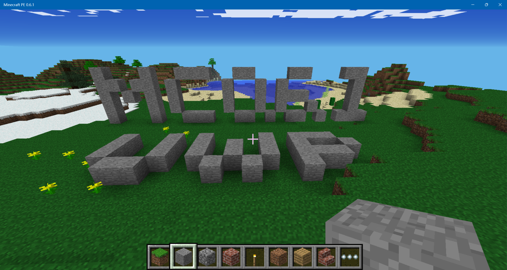

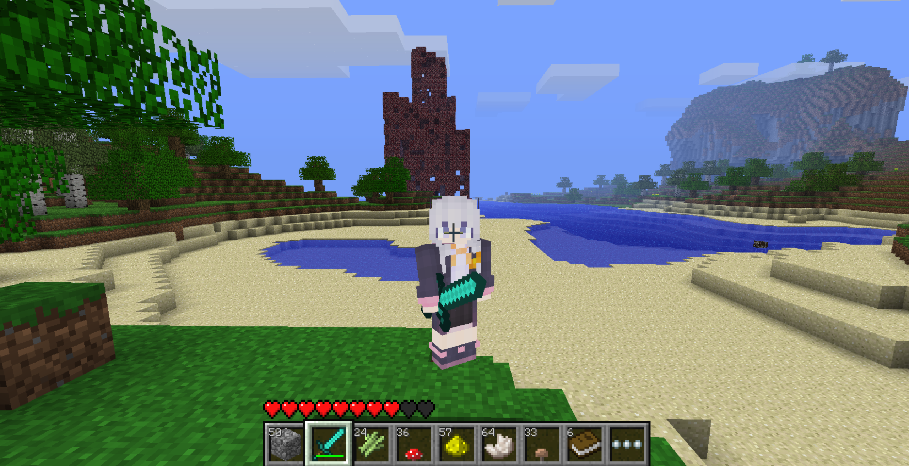

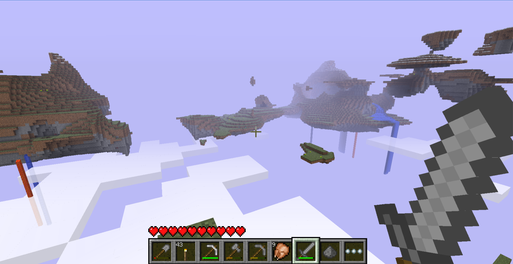

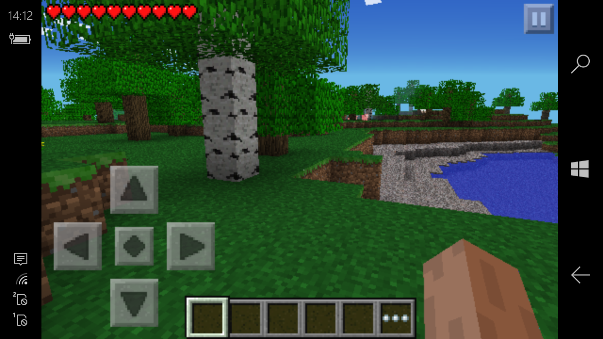

---

<h2 align="center">Project status</h2>

| Target        | Status                                               | Build system  |
| ------------- | ---------------------------------------------------- | ------------- |
| Windows x86   | Supported                                            | Visual Studio |
| Windows x64   | Supported                                            | Visual Studio |
| Windows ARM64 | Supported                                            | Visual Studio |
| Windows ARM32 | Selected WOA and Mobile systems tested and supported | Visual Studio |

This project focuses on UWP. Other platforms (Android, iOS) are not intended targets.

---

<h2 align="center">Upstream projects and references</h2>

This UWP project was transplanted from my win32 version [Minecraft-PE-0.6.1-Windows-Universal](https://github.com/CanghaiDragon/Minecraft-PE-0.6.1-Windows-Universal). The main features are the same. Below I will mention a few unique features of this UWP version.

In early 2026, the source code of Minecraft Pocket Edition v0.6.1 was leaked on the Internet. You can find it at [Minecraft PE Source Code](https://archive.org/details/Minecraftpesorucecode). This is the reason why several revisions of MCPE0.6.1 appear on GitHub and other sites. This project is also a revision of the original source code. **None** of the revisions is directly authorized by Mojang.

This project originated from [programmer1o1/MinecraftPE-v0.6.1](https://github.com/programmer1o1/MinecraftPE-v0.6.1), referred to below as **Project B**. Project B provides the main modernized source base and multi-platform porting work.

Some Java Beta visual ideas and related implementation details were studied from [minecraft-pe-0.6.1-on-all](https://github.com/Minecraft-PE-0-6-1/minecraft-pe-0.6.1-on-all), referred to below as **Project A**.

The Sky world and several visual behaviors were implemented with reference to Minecraft Java Edition Beta 1.7.3 source code using Mod Coder Pack 4.3. Alpha world is referenced to Java Edition Alpha 1.1.2_01 using Mode Coder Pack 1.6. These references do not imply official affiliation or authorization by Mojang.

A few images come from [Minecraft Wiki](https://minecraft.wiki/). Appx resources come from the official [Windows Phone 8.1 version of Minecraft PE](https://microsoft.com/p/-/9wzdncrdzsbb).

The main work of this project is assisted with the help of Codex.

---

<h2 align="center">Features</h2>

### Original MCPE features

- Old finite-world generation
- Mobs, lighting, sky rendering and the Nether Reactor Tower
- Touchscreen controls

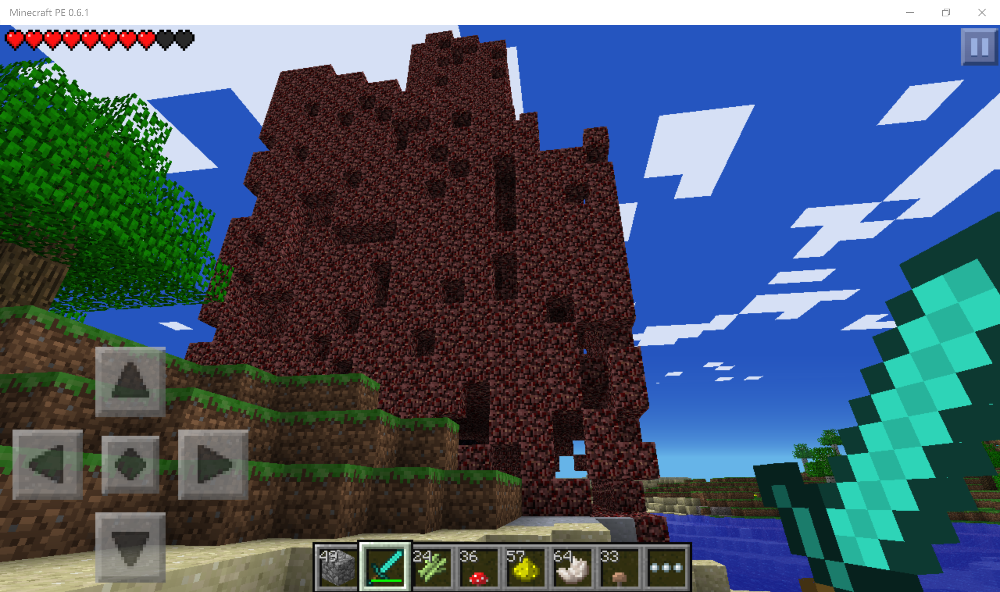

The terminated Nether Reactor Towel

### Additional gaming features

The additional features below can be experienced after opening the corresponding settings in Options → Additional. If you wish to have an experience close to the original MCPE 0.6.1, you can leave those settings off.

- Additional world type (Infinite, Sky and Alpha)

- Java Edition Beta visual effects

- Skin settings and skin import support

- Touch sneak option

- F3 Debug Screen

- Java Edition style UI

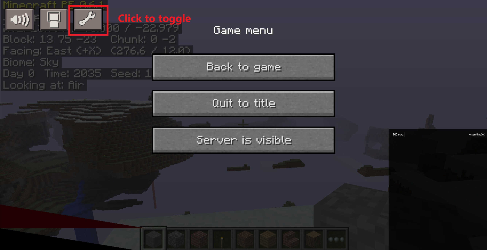

F3 Debug Screen

### Improvements

- Keyboard and mouse controls, with various improvements
- Selectable touch or keyboard/mouse input mode
- Creative-mode running
- Multiple key mapping options
- Render distance and smooth-lighting options
- Fullscreen support

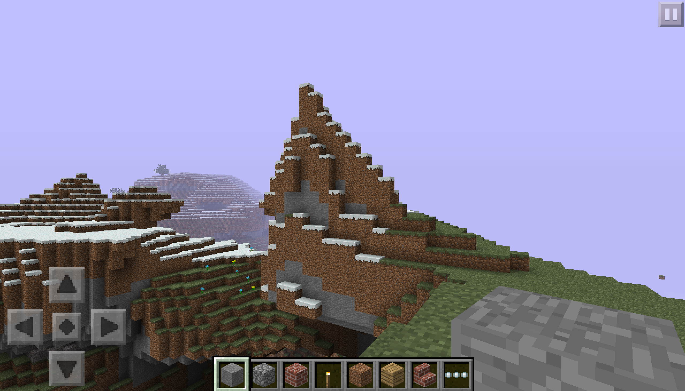

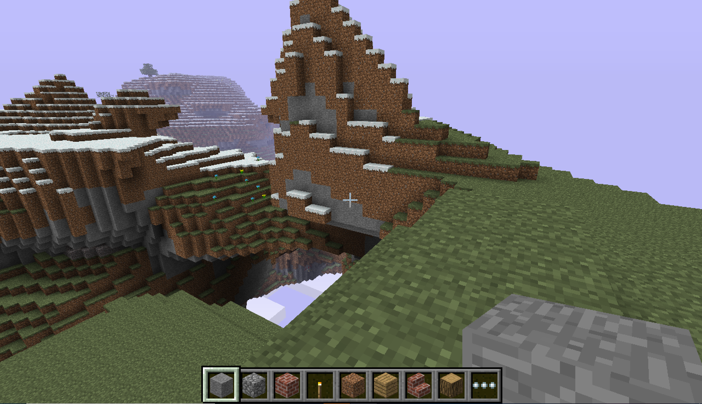

Different gaming screenshots under different input mode

### Interface and customization

- Welcome screen for choosing input mode, performance setting and GUI scale
- Adjustable GUI and D-pad sizes
- Adaptive layouts for various screen resolutions, from Windows Phone screen to Desktop window.

---

<h2 align="center">World types</h2>

**IMPORTANT**: Infinite, Sky and Alpha world have a level saving format different from both the original MCPE 0.6.1 and later MCPE infinite versions like 0.9. Therefore, these three world types **CANNOT** be converted and opened in any versions of original MCPE at the moment. Future plans include Infinite/Sky world conversion tools for later MCPE versions. Meanwhile, classic finite worlds retain the original MCPE 0.6.1 save format. saves from 0.1-0.8 original PE are supported.

### Old (finite) world

The original world type uses the same generator as the original MCPE 0.6.1. Players can play in a world with a boundary of 256×256, and the outer space is filled with invisible bedrock. Cave is unabled in the origin 0.6.1, and this version inherits this feature. Note that due to random-number variation, the spawn point in Creative mode and Survival mode is different in the original MCPE 0.6.1. This project inherits this feature.

### Infinite world

Infinite worlds use multi-region chunk storage and support exploration beyond the original 256×256 world boundary. The generator is adapted from the finite generator, which means you can find the exact same terrain as the finite world at coordinates within the finite-world boundary when using the same seed. The feature of different spawn points in Survival and Creative modes is also inherited. Cave is enabled.

### Sky world

Sky world is a floating-island world type based on the unused Sky dimension logic in Java Edition Beta 1.6 - 1.8. It uses a fixed Sky biome and separate terrain generation rules. Clouds are below the floating island. The sky color is light purple (only when Java Beta Visual is enabled). Cave is enabled. Several changes have been made to ensure playability in Survival mode:

- 4 types of animals can all spawn instead of only chickens. Chickens still have a higher spawn rate than the other three types of animals.

- Day-night cycle is kept in survival mode.

- The lowest block of the floating island is around Y = 18, so in Java Edition, diamonds cannot spawn in Sky. Here, ores generate in the height range where blocks generate, so diamonds can be found. Rate of gold ores is also increased, easier for making nether reactor.

- To balance the difficulty, mobs only spawn when the light level is low enough and there is at least one block above along the Y axis, which means mobs do not spawn at night in open areas.
  
  

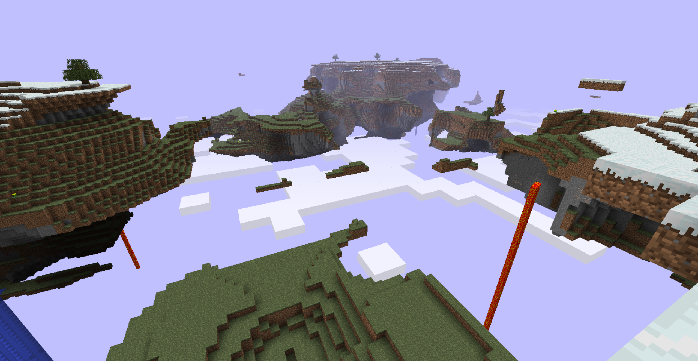

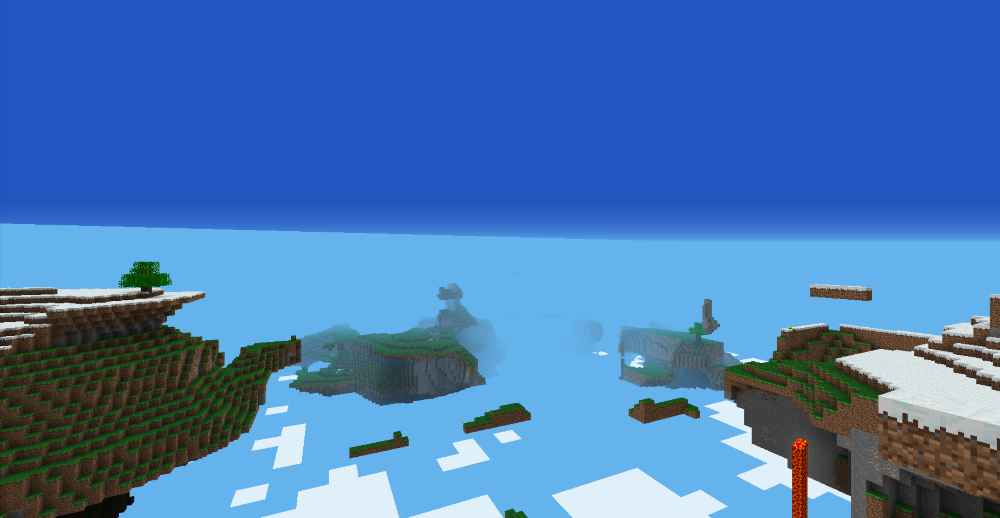

Difference view of Sky world under Java Beta and PE visual

### Alpha World

The world type based on Java Edition Alpha v1.1.2_01. Only the biome "Alpha" or "Winter" will generate to stimulate the situation of Java Edition early stage. Trees and grass blocks are in light green colors, separate from later Minecraft versions. Cave is enabled. There is a chance of 25% to enter the "Winter" world when creating a Alpha world.

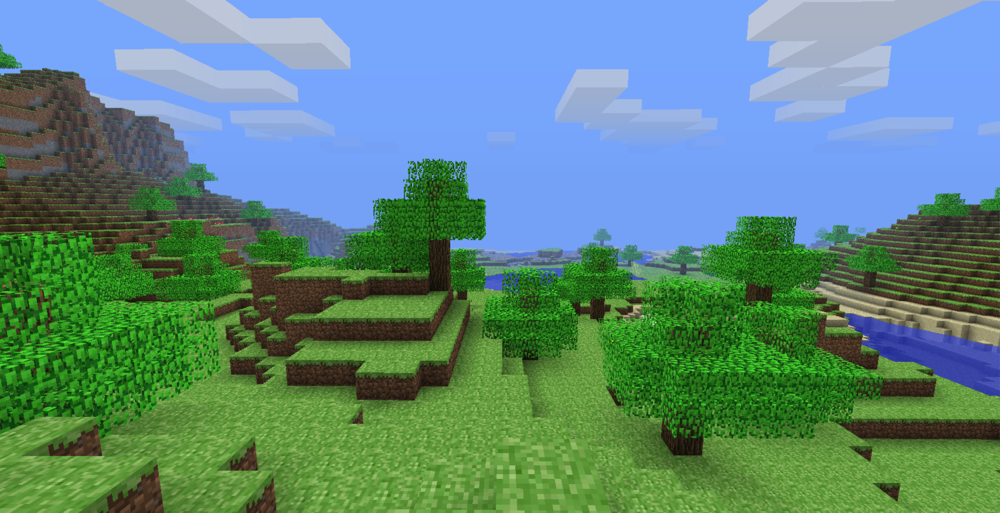

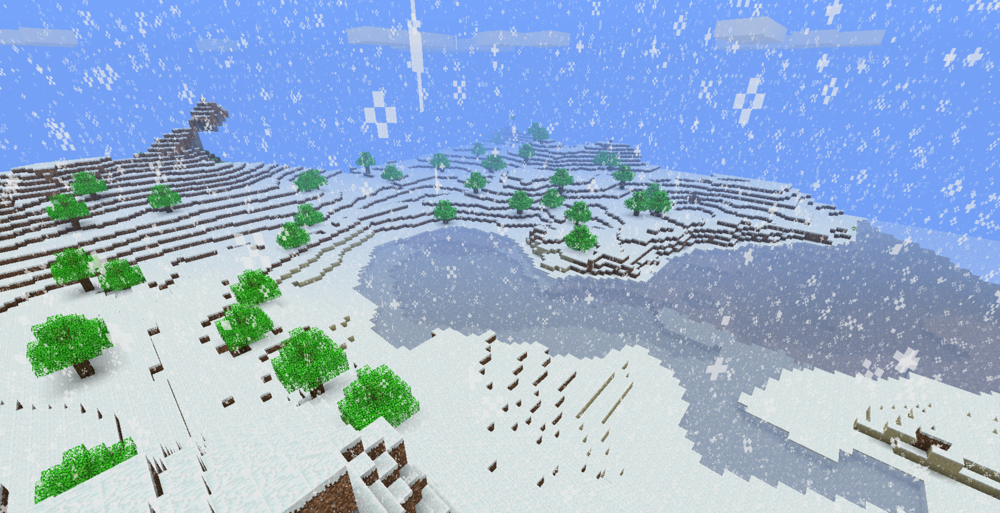

Normal Alpha world and the special "Winter" Alpha world

---

<h2 align="center">UWP related features</h2>

To adapt UWP app style, several functions with native XAML interfaces are added, including optimized skins, saves editing, importing and exporting, and key mapping. Players can import and export their worlds within the game, without visiting UWP data folder.

Dynamic Live Tiles and adaptation to UWP navigation bar are also added.

---

<h2 align="center">Core technical implementation</h2>

- Ported the game to Windows Universal Platform with native UWP application lifecycle and XAML integration.
- Added x86, x64, ARM32 and ARM64 build configurations.
- Reworked the rendering backend for platform-specific OpenGL and ANGLE paths.
- Added keyboard, mouse and touchscreen input abstraction.
- Added multi-region storage and new Infinite/Sky world-generation systems.
- Reworked chunk loading, chunk-boundary rendering and lighting updates for extended worlds.
- Preserved the original finite-world format and its interoperability with original PE multiplayer.
- Added architecture-specific packaging and runtime dependency handling.

---

<h2 align="center">Installation</h2>

Prebuilt AppX packages for x86, x64, ARM32 and ARM64 are available on the [Releases](https://github.com/CanghaiDragon/Minecraft-PE-0.6.1-UWP/releases) page.

### 1. Enable sideloading

Before installing the game, make sure Windows allows the installation of apps from outside the Microsoft Store.

* **Windows 10:** Open **Settings → Update & Security → For developers**, then enable **Sideload apps** (or **Developer mode**, depending on your Windows version).

* **Windows 11:** Open **Settings → System → For developers** and enable **Developer Mode** if required by your system.

* **Windows 10 Mobile:** Open **Settings → Update & security → For developers** and enable **Sideload apps** or **Developer mode**.

### 2. Install the certificate

If the AppX package is signed with a certificate that is not already trusted by your device, you must install the signing certificate before installing the game.

1. Locate the `.cer` certificate provided with the release.

2. On Windows desktop, open the certificate and select **Install Certificate**.

3. Select **Local Machine** and manually place the certificate in **Trusted People**.

4. Complete the certificate installation. Administrator permission may be required.

**Important:** Only install certificates from sources you trust. Do not install certificates into **Trusted Root Certification Authorities** unless specifically necessary and you understand the security implications.

For Windows 10 Mobile, certificate installation may require transferring the `.cer` file to the phone and opening it there.

### 3. Install the AppX package

1. The main package is an appxbundle containing all 4 architectures. After installing the needed dependency, it can be directly installed.

2. If the release includes a `Dependencies` folder, install the required dependency packages for your architecture first.

3. Open the `.appxbundle` file and follow the installation prompts.

4. Launch **Minecraft PE 0.6.1 UWP** from the Start menu or app list.

If the package cannot be installed by double-clicking, you can also use PowerShell on Windows desktop:
    Add-AppxPackage -Path "appxbundle filename"

Replace the filename with the actual package name.

If Windows reports a missing framework dependency, install the corresponding package from the release's `Dependencies` folder before retrying.

### Notes

* Use the package matching your device's CPU architecture.

* ARM32 packages are primarily intended for compatible Windows 10 Mobile and Windows on ARM devices.

* Windows 8 (Metro) is not supported by this UWP version.

* If installation fails, check that sideloading is enabled, the signing certificate is trusted, and all required dependencies are installed.

---

<h2 align="center">Building</h2>

This repository is built as a UWP application. Open the UWP solution below; the separate Win32, x64 and ARM solutions are the legacy win32 build, and are not the entry points for this repository’s UWP build.

`handheld/project/uwp/MCPEUWP.sln`

The solution contains one UWP project named `MCPEUWP`. Select `Debug` or `Release`, together with one of the following solution platforms:

| Solution platform | Target architecture | Project platform |
| ----------------- | ------------------- | ---------------- |
| x86               | Windows x86         | Win32            |
| x64               | Windows x64         | x64              |
| ARM               | Windows ARM32       | ARM              |
| ARM64             | Windows ARM64       | ARM64            |

The current project uses the Visual Studio v143 toolset and Windows SDK `10.0.19041.0`. The project also references the Windows Mobile Extension SDK `10.0.19041.0`, which is required for the Windows 10 Mobile target. Release builds are recommended for normal performance testing. Debug builds are intended for debugging and may run substantially slower.

The ANGLE headers, import libraries and runtime DLLs required by the ARM32 and ARM64 configurations are bundled under `third_party/angle_arm32` and `third_party/angle_arm64`. Other native libraries are kept under `handheld/lib`. Game data is included from `handheld/data` by the UWP project; it does not need to be copied from the separate Universal repository.

After building or packaging, the generated artifacts are placed under `AppPackages`. For sideloading, run the generated `Add-AppDevPackage.ps1` from the test-package directory and keep its architecture-specific `Dependencies` directory together with the package. The optional `Release-ANGLE-Test|ARM` configuration is only for ARM32 ANGLE diagnostics and is not required for normal builds.

---

<h2 align="center">Keyboard Controls</h2>

Below are the default keyboard controls for keyboard input. They can be revised in game using Options → Controls → Key Mapping.

| Key / Action | Function                    |
| ------------ | --------------------------- |
| W A S D      | Move                        |
| Space        | Jump                        |
| Left Shift   | Sneak                       |
| Left click   | Mine / Attack               |
| Right click  | Place block / Interact      |
| 1 - 9        | Select hotbar slot          |
| Scroll wheel | Scroll hotbar               |
| E            | Open inventory              |
| Ctrl         | Toggle run (Creative)       |
| F            | Toggle Spectator (Creative) |
| Q            | Drop item                   |
| R            | Crafting (Survival)         |
| F1           | Toggle hide HUD             |
| F3           | Toggle Debug Screen         |
| F5           | Toggle third-person view    |
| Escape       | Pause / back                |

---

<h2 align="center">Known limitations</h2>

- Block-destruction vibration is currently not working on the tested Lumia 640.
- Multiplayer for Infinite and Sky worlds is not currently supported.

---

<h2 align="center">Future plans</h2>

- Chinese localization

- Infinite/Sky world conversion tools for later MCPE versions (Already in Progress!)

- Possible achievement system

- Multiplayer for Infinite/Sky world

---

<h2 align="center">Attribution</h2>

This repository is an independent continuation based on leaked Minecraft Pocket Edition 0.6.1 source code and related community projects. Please retain the upstream references when redistributing source code or derivative work.

The project is not affiliated with or endorsed by Mojang Studios or Microsoft.
