<h1 align="center">Minecraft PE 0.6.1 UWP</h1>

<a href="README.md">English</a>

本项目是基于泄露的 Minecraft Pocket Edition 0.6.1 源代码开发的、以 Windows 为主要目标平台的延续项目。项目在 Windows 通用平台（UWP）上对游戏进行现代化移植与维护，并改进了输入、渲染、世界生成和用户界面。本项目面向运行 Windows 10 和 Windows 11 的 UWP 设备，包括台式电脑、平板电脑及 Windows 10 Mobile 设备。

如果你对 Win32 版本感兴趣，请访问 [Minecraft PE 0.6.1 Windows Universal](https://github.com/CanghaiDragon/Minecraft-PE-0.6.1-Windows-Universal)。

本项目仅用于教育与软件保存目的。欢迎 Fork 本项目，但**请勿将其用于商业用途**。

---

<h2 align="center">游戏截图</h2>

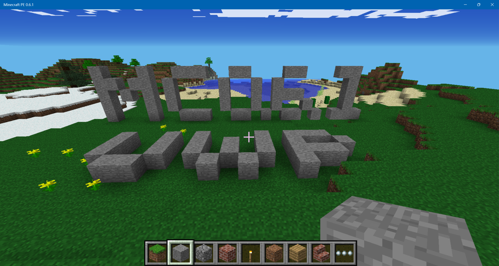

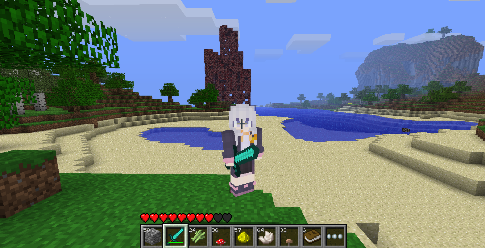

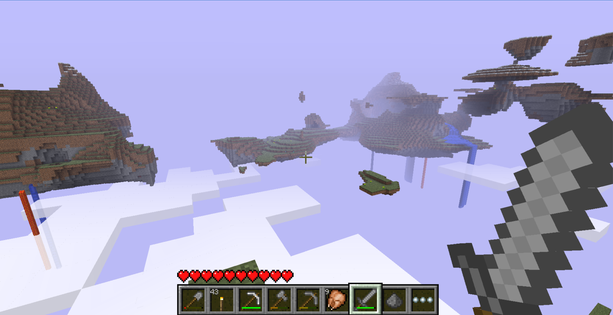

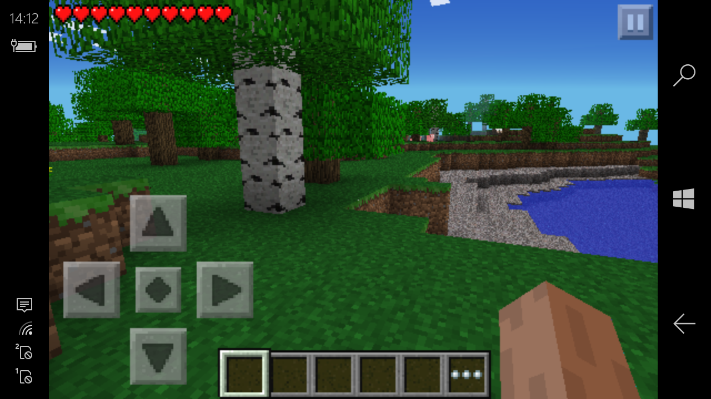

---

<h2 align="center">项目状态</h2>

| 目标平台          | 状态                                 | 构建系统          |
| ------------- | ---------------------------------- | ------------- |
| Windows x86   | 支持                                 | Visual Studio |
| Windows x64   | 支持                                 | Visual Studio |
| Windows ARM64 | 支持                                 | Visual Studio |
| Windows ARM32 | 已在部分 WOA 和 Windows Mobile 系统上测试并支持 | Visual Studio |

本项目专注于 UWP。其他平台（Android、iOS）不属于本项目的目标平台。

---

<h2 align="center">上游项目与参考资料</h2>

本 UWP 项目由我此前的 Win32 版本 [Minecraft-PE-0.6.1-Windows-Universal](https://github.com/CanghaiDragon/Minecraft-PE-0.6.1-Windows-Universal) 移植而来，主要功能基本相同。下文将介绍 UWP 版本的一些独有功能。

2026 年 3 月，Minecraft Pocket Edition v0.6.1 的源代码在互联网上泄露，可以在 [Minecraft PE Source Code](https://archive.org/details/Minecraftpesorucecode) 找到。这也是 GitHub 等网站上出现多个 MCPE 0.6.1 修改版本的原因。本项目同样是基于原始代码开发的修改版本。这些修改版本均**未获得 Mojang 的直接授权**。

本项目源自 [programmer1o1/MinecraftPE-v0.6.1](https://github.com/programmer1o1/MinecraftPE-v0.6.1)，下文称为 **Project B**。Project B 提供了主要的现代化源码基础以及多平台移植工作。

部分 Java Beta 视觉效果的思路和相关实现参考了 [minecraft-pe-0.6.1-on-all](https://github.com/Minecraft-PE-0-6-1/minecraft-pe-0.6.1-on-all)，下文称为 **Project A**。

天域世界以及部分视觉效果参考了 Minecraft Java Edition Beta 1.7.3 的源代码，并使用 Mod Coder Pack 4.3：[mcp43](https://www.mediafire.com/file/03d94f13c9ulj5a/mcp43.zip)。上述参考并不意味着本项目与 Mojang 存在任何官方关联或获得其授权。

部分图片来自 [Minecraft Wiki](https://minecraft.wiki/)。AppX 资源来自官方 [Windows Phone 8.1 版 Minecraft PE](https://microsoft.com/p/-/9wzdncrdzsbb)。

本项目的主要开发工作在 Codex 的协助下完成。

---

<h2 align="center">功能</h2>

### 原版 MCPE 功能

- 原版有限世界生成
- 生物、光照、天空渲染以及下界反应塔
- 触摸屏操作

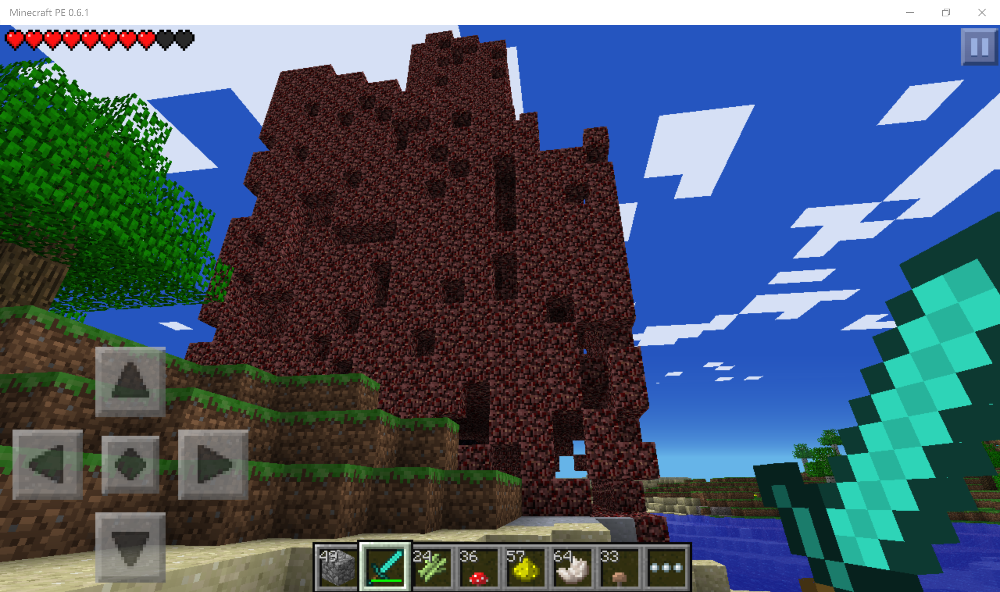

运行结束后的下界反应堆塔

### 额外游戏功能

以下功能可通过“Options（选项）”→“Additional（附加设置）”中的对应设置体验。如果希望获得接近原版 MCPE 0.6.1 的游戏体验，可以保持这些选项关闭。

- 更多世界类型（Infinite 无限世界和 Sky 天域世界）

- Java Edition Beta 风格视觉效果

- 皮肤设置和皮肤导入支持

- 触摸屏潜行选项

- F3 调试界面

- Java Edition 风格 UI

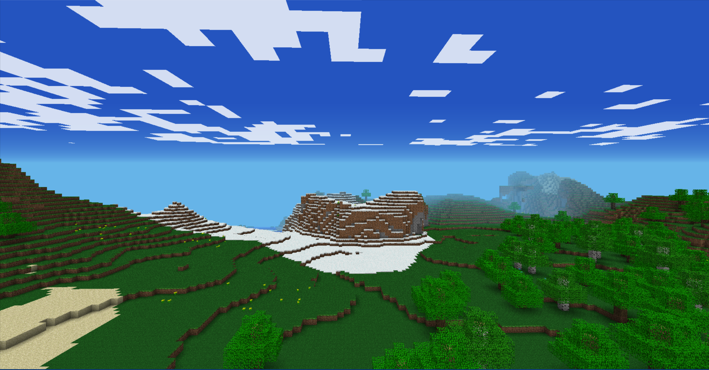

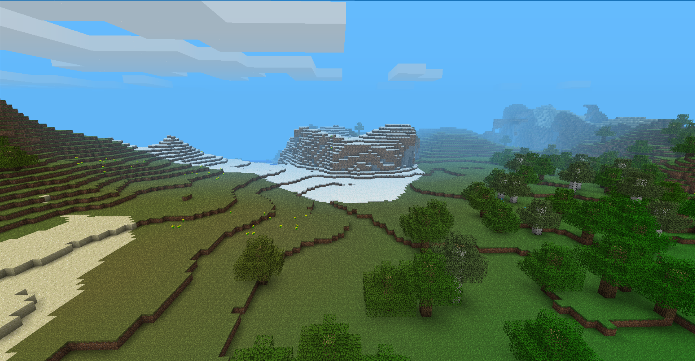

原版 PE 视觉效果与 Java Beta 视觉效果对比

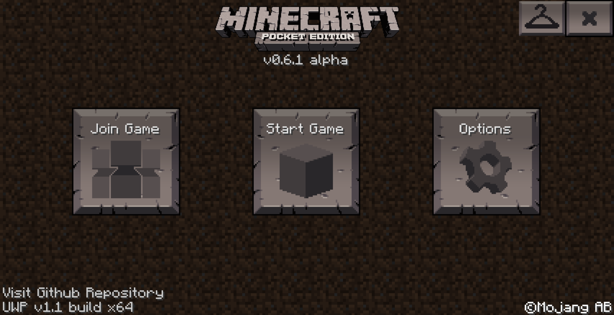

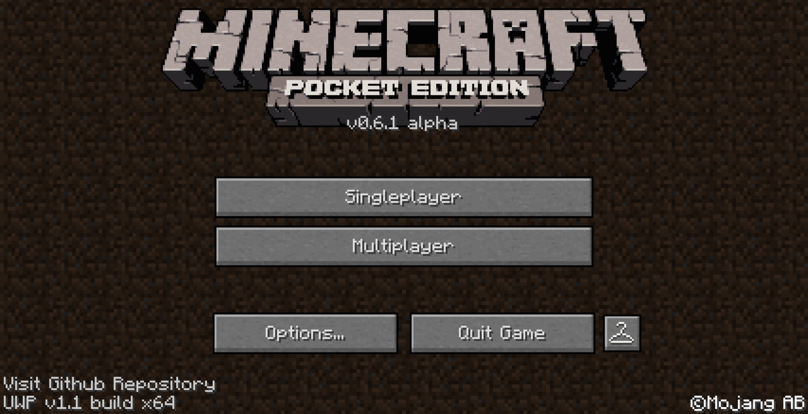

原版 UI 与 Java Edition 风格 UI 对比

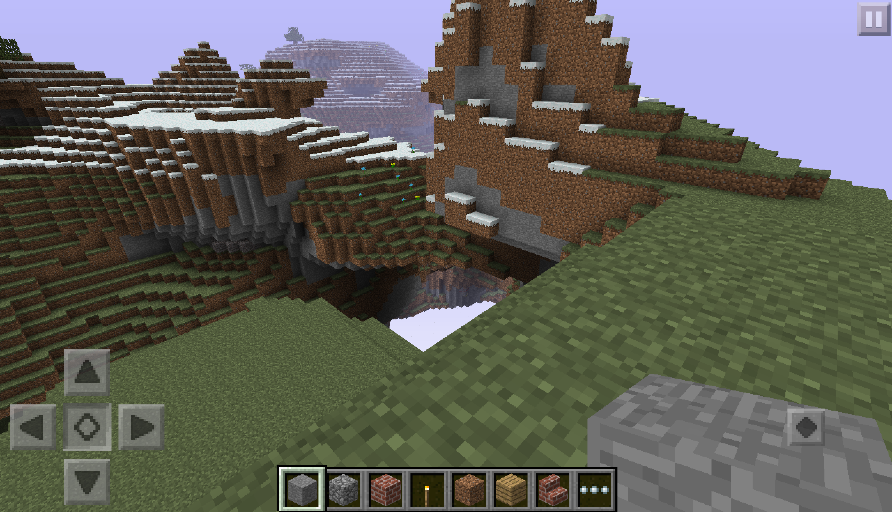

触摸输入模式下的潜行功能

自定义皮肤

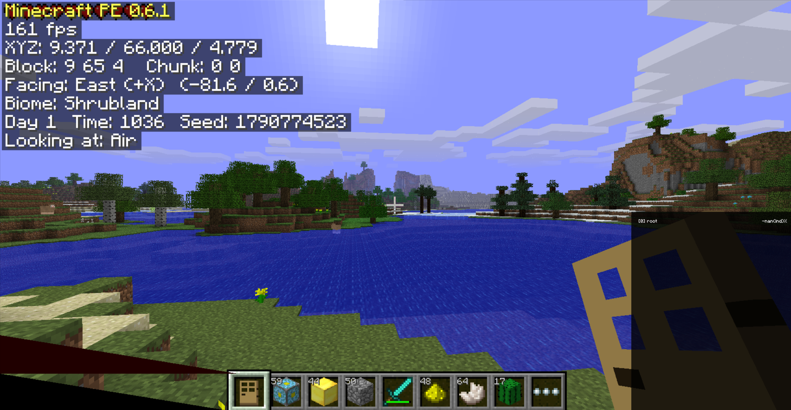

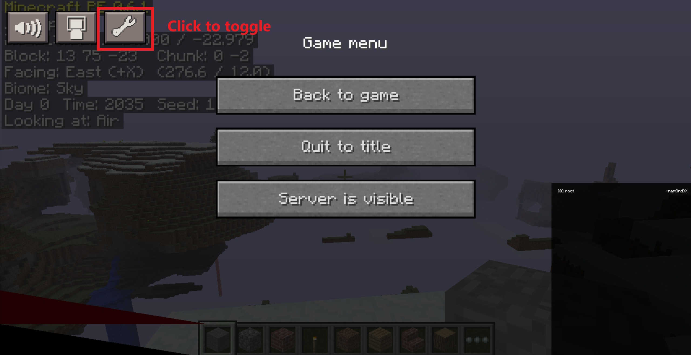

F3 调试界面

### 改进

- 键盘和鼠标操作及相关改进
- 可选择触摸或键盘/鼠标输入模式
- 创造模式下的疾跑
- 多种按键映射选项
- 渲染距离和平滑光照选项
- 全屏支持

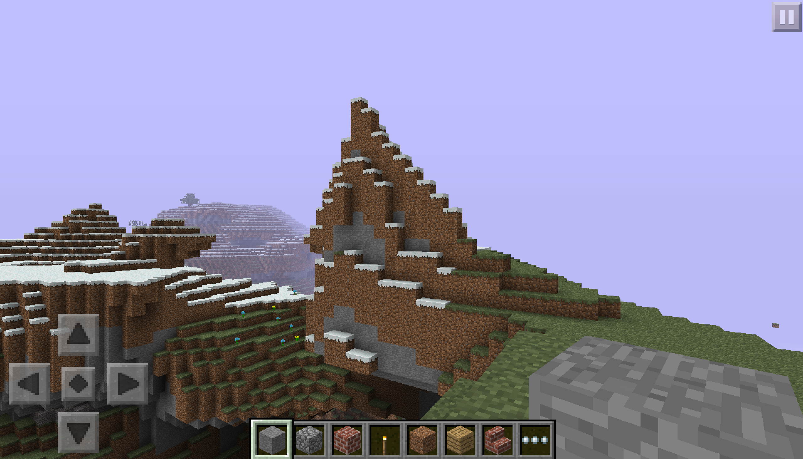

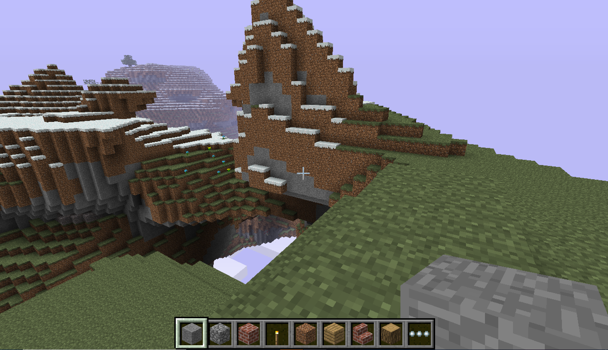

不同输入模式下的游戏画面

### 界面与自定义

- 欢迎界面，可选择输入模式、性能设置和 GUI 缩放比例
- 可调整 GUI 和方向键大小
- 自适应不同屏幕分辨率，从 Windows Phone 屏幕到桌面窗口均可适配

---

<h2 align="center">世界类型</h2>

**重要提醒：** Infinite（无限）和 Sky（天域）世界采用的存档格式既不同于原版 MCPE 0.6.1，也不同于 MCPE 0.9 等后续版本的无限世界。因此，目前这两种世界**无法**转换并在任何原版 MCPE 中打开。未来计划开发将 Infinite/Sky 世界转换至后续 MCPE 版本的工具。与此同时，经典有限世界保留了原版 MCPE 0.6.1 的存档格式，并支持原版 PE 0.1–0.8 的存档。

### Old（有限）世界

原版世界类型，使用与原版 MCPE 0.6.1 相同的生成机制。玩家可以在边界为 256×256 的世界中游玩，世界外围由隐形基岩包围。需要注意的是，由于随机数的差异，原版 MCPE 0.6.1 中创造模式和生存模式的出生点并不相同。本项目保留了这一特性。

### Infinite（无限）世界

无限世界采用多 Region 区块存储，可以探索原版 256×256 世界边界之外的区域。其生成器由有限世界生成器改造而来，因此使用相同种子时，在有限世界边界范围内可以生成与有限世界完全相同的地形。生存模式与创造模式出生点不同的特性同样得到保留。

### Sky（天域）世界

天域世界是一种浮空岛世界类型，基于 Minecraft Java Edition Beta 1.6–1.8 中未实装的 Sky Dimension 逻辑实现。它使用固定的 Sky 生物群系以及独立的地形生成规则。云层位于浮岛下方。启用 Java Beta Visual 后，天空呈浅紫色。为了确保生存模式下的可玩性，本项目进行了以下调整：

- 四种动物均可生成，而非只有鸡可以生成。鸡相较其他三种动物仍拥有更高的生成概率。
- 生存模式中保留昼夜循环。
- 浮岛最低的方块大约位于 Y = 18，因此在 Java 版原始 Sky 世界中钻石无法生成。本项目调整了矿石生成高度，使矿石可以在实际存在方块的高度范围内生成，因此可以找到钻石。
- 为平衡难度，怪物只有在光照足够低，并且 Y 轴上方至少存在一个方块时才会生成。这意味着夜间的露天区域不会刷怪。

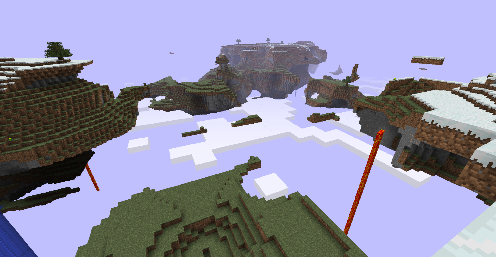

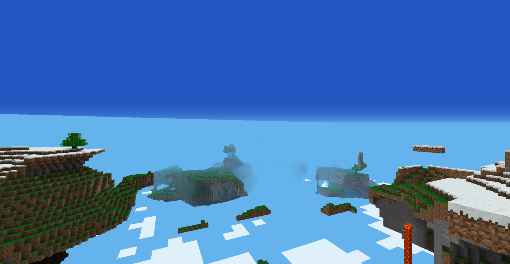

天域在 Java Beta 与原版 PE 视觉效果下的对比

---

<h2 align="center">UWP 相关功能</h2>

为了适应 UWP 应用的使用方式，本项目新增了多个采用原生 XAML 界面的功能，包括皮肤优化、存档编辑、导入与导出，以及按键映射。玩家可以直接在游戏内导入和导出世界，无须访问 UWP 应用数据目录。

此外，还加入了动态磁贴功能，并适配了 UWP 返回键。

---

<h2 align="center">核心技术实现</h2>

- 将游戏移植至 Windows 通用平台（UWP），接入原生 UWP 应用生命周期与 XAML 界面。
- 增加 x86、x64、ARM32 和 ARM64 构建配置。
- 调整渲染后端，以适配不同平台的 OpenGL 和 ANGLE 路径。
- 增加键盘、鼠标和触摸屏输入抽象层。
- 增加多 Region 存储，以及新的 Infinite/Sky 世界生成系统。
- 改进扩展世界的区块加载、区块边界渲染和光照更新。
- 保留原版有限世界格式及其与原版 PE 多人游戏的互通能力。
- 增加针对不同处理器架构的打包和运行时依赖处理。

---

<h2 align="center">构建</h2>

本仓库以 UWP 应用的形式构建。请打开以下 UWP 解决方案；其他独立的 Win32、x64 和 ARM 解决方案属于旧版 Win32 构建，并非本仓库 UWP 版本的构建入口。

`handheld/project/uwp/MCPEUWP.sln`

该解决方案包含一个名为 `MCPEUWP` 的 UWP 项目。请选择 `Debug` 或 `Release` 配置，以及以下解决方案平台之一：

| 解决方案平台 | 目标架构          | 项目平台  |
| ------ | ------------- | ----- |
| x86    | Windows x86   | Win32 |
| x64    | Windows x64   | x64   |
| ARM    | Windows ARM32 | ARM   |
| ARM64  | Windows ARM64 | ARM64 |

当前项目使用 Visual Studio v143 工具集和 Windows SDK `10.0.19041.0`。项目还引用了 Windows Mobile Extension SDK `10.0.19041.0`，Windows 10 Mobile 目标需要该 SDK。正常性能测试建议使用 Release 构建。Debug 构建主要用于调试，运行速度可能明显更慢。

ARM32 和 ARM64 配置所需的 ANGLE 头文件、导入库和运行时 DLL 位于 `third_party/angle_arm32` 和 `third_party/angle_arm64`。其他原生库位于 `handheld/lib`。游戏数据由 UWP 工程从 `handheld/data` 自动纳入，不需要从单独的 Universal 仓库复制。

构建或打包后，生成的文件位于 `AppPackages`。侧载安装时，请从生成的测试包目录运行 `Add-AppDevPackage.ps1`，并保持该目录下对应架构的 `Dependencies` 文件夹与安装包一起存在。可选的 `Release-ANGLE-Test|ARM` 配置仅用于 ARM32 ANGLE 诊断，普通构建不需要选择它。

---

<h2 align="center">键盘操作</h2>

以下为键盘输入模式下的默认操作，可在游戏内通过 Options → Controls → Key Mapping 修改。

| 按键 / 操作    | 功能             |
| ---------- | -------------- |
| W A S D    | 移动             |
| Space      | 跳跃             |
| Left Shift | 潜行             |
| 鼠标左键       | 挖掘 / 攻击        |
| 鼠标右键       | 放置方块 / 交互      |
| 1 - 9      | 选择快捷栏槽位        |
| 鼠标滚轮       | 切换快捷栏物品        |
| E          | 打开物品栏          |
| Ctrl       | 切换疾跑状态（仅限创造模式） |
| F          | 切换旁观模式（仅限创造模式） |
| Q          | 丢弃物品           |
| R          | 打开合成界面（仅限生存模式） |
| F1         | 切换 HUD 显示/隐藏   |
| F3         | 切换调试界面         |
| F5         | 切换第三人称视角       |
| Escape     | 暂停 / 返回        |

---

<h2 align="center">已知限制</h2>

- 在已测试的 Lumia 640 上，破坏方块时的震动反馈目前无法正常工作。
- 目前不支持 Infinite（无限）和 Sky（天域）世界的多人联机。
- 悬崖下方可能出现光照异常；玩家靠近后通常可以恢复正常。

---

<h2 align="center">未来计划</h2>

- 新增中文
- 改进区块渲染机制
- 为后续 MCPE 版本开发 Infinite/Sky 世界转换工具
- 成就系统（生存模式）
- Infinite/Sky 世界多人联机

---

<h2 align="center">署名与声明</h2>

本仓库是基于泄露的 Minecraft Pocket Edition 0.6.1 源代码以及相关社区项目开发的独立延续项目。重新分发源代码或衍生项目时，请保留对上游项目的引用。

本项目与 Mojang Studios 或 Microsoft 无任何隶属关系，也未获得其认可或背书。
